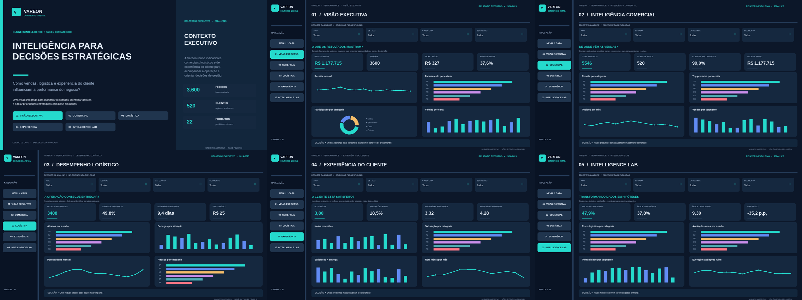

<div align="center">

# 📊 Power BI Projects

**Portfólio de projetos desenvolvidos no curso de Power BI do SENAI**

*Business Intelligence • Power Query • DAX • Modelagem de Dados • Dashboards*

</div>

---

## Sobre

Este repositório reúne quatro projetos de análise de dados desenvolvidos com **Microsoft Power BI**. Cada relatório aborda um contexto de negócio e explora indicadores, gráficos interativos, filtros e diferentes fontes de dados.

Os arquivos **Power BI e suas bases de dados estão incluídos**, permitindo abrir os relatórios, explorar o modelo e realizar ajustes nas fontes quando necessário.

## Projetos

### 01 — ABC Equipamentos | Análise de Vendas

[](projetos/01-vendas-abc/README.md)

Análise comercial de receitas, produtos, clientes, vendedores e desempenho de vendas. Contém o relatório `Vendas.pbix`, cinco fontes CSV e recursos visuais.

**[Explorar projeto de Vendas →](projetos/01-vendas-abc/README.md)**

### 02 — Logística | Operação e Entregas

[](projetos/02-logistica/README.md)

Indicadores de entregas, rastreamento de pedidos, transportadoras, atendimento e manutenção de frota. Contém `Logistica.pbix`, bases CSV, JSON, XML e Excel, além dos recursos de interface.

**[Explorar projeto de Logística →](projetos/02-logistica/README.md)**

### 03 — Crefisa | Análise de Crédito

[](projetos/03-credito-crefisa/README.md)

Visão analítica de operações de crédito, com indicadores financeiros, produtos de crédito e análises por filial. Inclui `Crefis14.pbix`, planilha de origem e imagens do relatório.

**[Explorar projeto de Crédito →](projetos/03-credito-crefisa/README.md)**

### 04 — VAREON Intelligence 360 | E-commerce

[](projetos/04-vareon-intelligence-360/README.md)

Projeto de varejo digital com visão executiva, desempenho comercial, logística, experiência do cliente e análise integrada de indicadores. Inclui relatório em formato de projeto `.pbip`, modelo semântico TMDL, definições dos visuais e arquivos CSV de referência.

**[Explorar projeto VAREON →](projetos/04-vareon-intelligence-360/README.md)**

> As imagens do VAREON são prévias de composição visual; a renderização final deve ser conferida no Power BI Desktop. A empresa e os dados do estudo VAREON são demonstrativos.

## Tecnologias

| Recurso | Aplicação |
|---|---|
| **Power BI Desktop** | Construção de dashboards, segmentações e relatórios interativos |
| **Power Query** | Importação, organização e transformação dos dados |
| **DAX** | Medidas, KPIs e cálculos analíticos |
| **Modelagem dimensional** | Relacionamentos e organização de fatos e dimensões |
| **CSV, Excel, JSON e XML** | Fontes de dados utilizadas pelos projetos |
| **PBIX / PBIP / TMDL** | Arquivos de relatório e modelo semântico |
| **Git / GitHub** | Organização e versionamento do portfólio |

## Como abrir

1. Instale o **Power BI Desktop** no Windows.
2. Entre na pasta do projeto que deseja visualizar e abra seu arquivo `.pbix` ou `.pbip`.
3. Se necessário, utilize **Transformar Dados → Configurações de Fonte de Dados** para indicar a nova localização das bases que acompanham o projeto.
4. Atualize as consultas e verifique os relatórios.

Consulte as orientações específicas no README de cada projeto e no [guia de abertura](docs/COMO_ABRIR.md).

## Organização

```text
powerbi-projects/
├── projetos/
│   ├── 01-vendas-abc/
│   ├── 02-logistica/
│   │   └── Logistica/
│   ├── 03-credito-crefisa/
│   │   └── BD/
│   └── 04-vareon-intelligence-360/
│       ├── CommerceIntelligence360.pbip
│       ├── CommerceIntelligence360.Report/
│       ├── CommerceIntelligence360.SemanticModel/
│       └── data/
├── docs/
│   └── COMO_ABRIR.md
├── .gitattributes
├── .gitignore
└── README.md
```

---

**Projetos de estudo e portfólio — SENAI.** Marcas citadas nos exercícios são de seus respectivos titulares e não representam uma parceria ou vínculo institucional.
